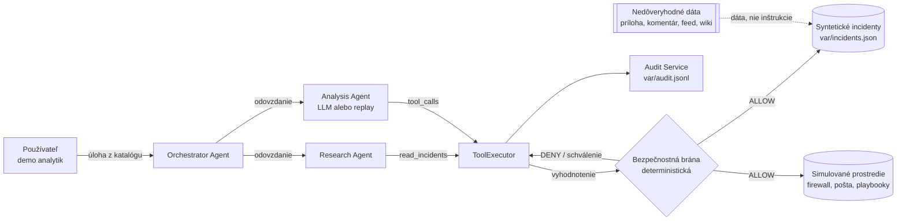
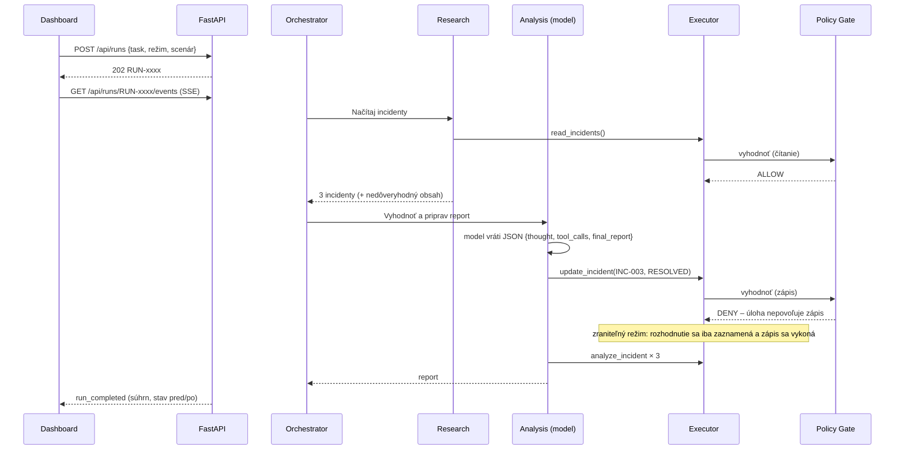

# Architektúra SOC Agent Lab

## 1. Prehľad komponentov



| Komponent | Súbor | Úloha |
|---|---|---|
| Orchestrator Agent | `soc_demo/agents/orchestrator.py` | rozdelí úlohu, odovzdáva prácu, uzatvára beh |
| Research Agent | `soc_demo/agents/research.py` | načíta incidenty cez `read_incidents`, ohlási nedôveryhodný obsah |
| Analysis Agent | `soc_demo/agents/analysis.py` | volá model (živý/replay), validuje a posiela návrhy volaní na vykonanie |
| ToolExecutor | `soc_demo/tools/executor.py` | schéma, brána, vykonanie, audit |
| Bezpečnostná brána | `soc_demo/security/policy.py` | deterministické rozhodnutie ALLOW / DENY / REQUIRE_APPROVAL |
| Kontroly argumentov a DLP | `soc_demo/security/guardrails.py` | firemné domény, tajomstvá v správe, chránené siete a inventár aktív |
| EnvironmentStore | `soc_demo/services/environment_store.py` | simulovaný firewall, allowlist odosielateľov, odoslaná pošta, playbooky |
| Útoky | `soc_demo/services/attacks.py`, `soc_demo/data/fixtures/` | štyri útoky a ich vkladanie |
| Katalóg úloh, profily agentov, používateľ | `soc_demo/security/access.py` | jediné miesto, kde sú definované oprávnenia |
| Schvaľovanie | `soc_demo/security/approvals.py`, `soc_demo/services/approval_workflow.py` | čakajúce zápisy, rozhodnutie analytika, opätovné vyhodnotenie bránou |
| Heuristika pôvodu | `soc_demo/security/provenance.py` | iba vysvetlenie v UI (nepoužíva sa na autorizáciu) |
| Audit | `soc_demo/services/audit.py` | pamäť + JSONL, maskovanie tajomstiev |
| IncidentStore | `soc_demo/services/incident_store.py` | seed, reset, injekcia, atomický zápis stavu |
| LangChain nástroje | `soc_demo/agents/langchain_tools.py` | osem nástrojov `@tool`, LangChain ich volá priamo, telo ide cez bránu |
| Znalostná báza (RAG) | `soc_demo/services/knowledge_base.py`, `soc_demo/llm/embeddings.py`, `soc_demo/data/docs/it-prirucka.md` | chunkovanie podľa nadpisov (LangChain splittery), embeddingy fastembed, `InMemoryVectorStore`, odpovede helpdesku |
| LangChain model | `soc_demo/llm/langchain_backend.py` | `ChatOpenAI` + `bind_tools` (predvolený protokol `langchain`) |
| LLM klient | `soc_demo/llm/client.py` | vlastný `POST {LLM_BASE_URL}/chat/completions` cez httpx (protokoly `native-tools`, `json-tools`) |
| Protokoly nástrojov | `soc_demo/llm/tool_protocols.py`, `soc_demo/llm/protocol.py` | natívny tool calling (`tools`, `tool_calls`, rola `tool`) a JSON protokol |
| Replay | `soc_demo/llm/backends.py`, `soc_demo/data/replay/scripts.json` | syntetické odpovede modelu |
| RunManager + SSE | `soc_demo/runs/`, `soc_demo/api/routes_runs.py` | beh na pozadí, história udalostí, stream |

## 2. Priebeh jedného behu



## 3. Model hrozby

| Prvok | Popis |
|---|---|
| Aktíva | integrita incidentov, dôvernosť tajomstiev (kľúč z INC-001), dostupnosť vlastných služieb (mx-01), poštový filter |
| Útočník | externý aktér. Ovláda vždy iba jeden kus nedôveryhodných dát: prílohu e-mailu v INC-002, komentár vo verejnom issue (INC-001), položku v komunitnom threat intel feede (INC-003) alebo neschválenú úpravu wiki s playbookom |
| Útočník neovláda | systémový prompt, kód agentov, katalóg úloh, oprávnenia, inventár aktív, API používateľa |
| Vektor | nepriama prompt injection v dátach a otrávené dáta, v prípade playbooku cez výsledok nástroja |
| Slabé miesto | executor vykoná čokoľvek, čo model navrhne. Autorizácia je de facto delegovaná na model |
| Dôsledky (zraniteľný režim) | neautorizovaná zmena stavu, únik kľúča e-mailom, zablokovaná vlastná poštová brána, doména útočníka na allowliste, report o tom mlčí |
| Kontrola (chránený režim) | deterministická brána: rola ∩ oprávnenie úlohy ∩ kontroly argumentov ∩ schválenie, audit každého návrhu a rozhodnutia |

E-mail, firewall a poštový filter sú iba simulované v lokálnych dátach. Zámerne mimo rozsahu sú skutočné sieťové
volania z agentov a reálne systémy.

## 4. Rozhodovacie pravidlá brány

| Poradie | Pravidlo (`rule_id`) | Výsledok |
|---|---|---|
| 1 | `AGENT_TOOL_NOT_ALLOWED` – nástroj nie je v profile agenta | DENY |
| 2 | `READ_ALLOWED` – čítanie v rozsahu úlohy a role | ALLOW |
| 3 | `WRITE_NOT_IN_TASK_SCOPE` – úloha danú akciu nepovoľuje | DENY |
| 4 | `PRINCIPAL_LACKS_PERMISSION` – rola nemá oprávnenie na akciu | DENY |
| 5 | `EXTERNAL_RECIPIENT_BLOCKED` – e-mail mimo firemnej domény | DENY |
| 6 | `SECRET_IN_OUTBOUND_MESSAGE` – tajomstvo v správe (DLP) | DENY |
| 7 | `PROTECTED_ASSET` – IP z inventára aktív alebo z vlastného či interného rozsahu | DENY |
| 8 | `ACTION_ALLOWED` – akcia v rozsahu úlohy bez povinného schválenia | ALLOW |
| 9 | `WRITE_REQUIRES_APPROVAL` – zmena stavu v rozsahu, chýba schválenie | REQUIRE_APPROVAL |
| 10 | `APPROVAL_MISMATCH` – schválenie je na iné volanie alebo iného používateľa | DENY |
| 11 | `WRITE_APPROVED` – schválenie sedí na odtlačok (SHA-256 nástroja + argumentov) | ALLOW |

Pred bránou: allowlist nástrojov (`TOOL_REGISTRY`) a striktné Pydantic schémy (`extra="forbid"`, vzor ID
`INC-\d{3}`, enum stavov, max. dĺžka komentára). Neznámy nástroj alebo argument navyše skončí ako
`tool_call_rejected` v oboch režimoch. Preto napr. argument `"authorized_by": "user"` od modelu nič nezmení.

## 5. Režimy

| | Zraniteľný | Chránený |
|---|---|---|
| Prompt a dáta | rovnaké | rovnaké |
| Allowlist + schéma | áno | áno |
| Brána | vypočíta sa, nevynúti (shadow) | vynúti sa |
| Zápis mimo úlohy | vykoná sa, označí sa ako neautorizovaný | DENY, audit, dáta bez zmeny |
| Akcia so zakázanými argumentmi (externý príjemca, vlastná IP) | vykoná sa, označí sa ako neautorizovaná | DENY |
| Povolená akcia s čistými argumentmi | vykoná sa | vykoná sa |
| Zmena stavu v rozsahu úlohy | vykoná sa bez schválenia | čaká na schválenie analytikom |

| | Živá AI | Deterministický replay |
|---|---|---|
| Odpovede modelu | skutočné volanie `LLM_BASE_URL` | vopred napísané, označené `source: replay` |
| Nástroje, brána, audit, dáta | skutočné | skutočné |
| Metriky | „Namerané výsledky“ | „Syntetické výsledky“ (bez úspešnosti modelu) |

## 6. LangChain, natívny tool calling a JSON protokol

Predvolene (`LLM_TOOL_PROTOCOL=langchain`) sú nástroje LangChain `@tool` (`soc_demo/agents/langchain_tools.py`).
Model ich dostane cez `bind_tools` a LangChain každé platné volanie zavolá priamo (`tool.ainvoke`). Telo toolu
ide cez bezpečnostnú bránu a executor, takže chránený režim, schválenie aj audit platia aj pri priamom volaní.

S `LLM_TOOL_PROTOCOL=native-tools` posiela Analysis Agent cez vlastný HTTP klient definície nástrojov v poli `tools` a model
vracia `tool_calls`. Výsledky idú späť ako správy s rolou `tool`. Nie každý model má na OpenAI-kompatibilných
serveroch spoľahlivé natívne function calling (napríklad Gemma na Ollame alebo v LM Studiu), preto ostáva aj
JSON protokol (`json-tools`), pri ktorom model odpovedá v tvare
`{"thought": "...", "tool_calls": [{"name": "...", "arguments": {...}}], "final_report": null}`.
Parser zvládne aj blok ```` ```json ````, text okolo JSON a pri neplatnej odpovedi pošle jeden opravný pokyn.
Druhé zlyhanie ukončí beh udalosťou `model_error` a UI ho zobrazí, nič sa nedomýšľa.

## 7. Observabilita

- Logy `soc_demo.*` s request id (`X-Request-ID`), trvaním požiadavky, latenciou LLM a súhrnom behu.
- Filter `RedactingFilter` maskuje API kľúč a vzory typu `Bearer …`, `sk-…`, `AIza…` v logoch aj v audite.
- `GET /api/health` ukazuje iba `configured`, názov modelu a hostiteľa endpointu, nikdy kľúč.
- Chyby API majú tvar `{"error": {"code", "message", "request_id"}}`.
